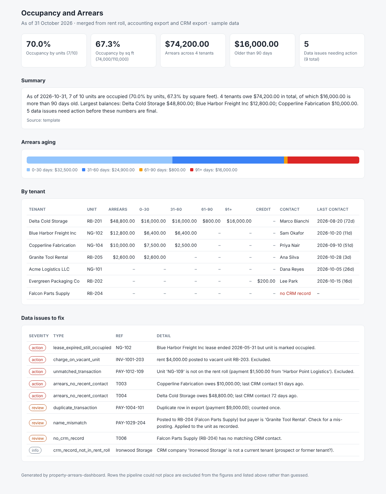

# property-arrears-dashboard

Merges three exports a property team usually keeps in separate systems:

- a **rent roll** (units, tenants, leases, rent, occupied/vacant),
- an **accounting export** (rent charges, late fees, payments, credits),
- a **CRM export** (tenant contacts, last contact date, notes),

into one **occupancy and arrears dashboard**, plus a list of the data problems a person needs to fix before the numbers can be trusted.

All data in `data/` is invented sample data for two fictional industrial properties.

> **How this was built:** AI-assisted, under my direction. I specified what the pipeline must do, the matching and aging rules, the messy cases the sample data had to contain and the expected answers; Claude generated the code; I reviewed it, ran it, checked the results against my hand-worked numbers, and directed the fixes. I can walk through every rule and decision in it. I did not hand-type the code.



Open [`docs/sample_dashboard.html`](docs/sample_dashboard.html) in a browser for the generated page.

## Interactive walkthrough

A step-by-step interactive page shows the whole flow: the three messy inputs, cleaning, matching (and refusing to match), oldest-charge-first aging for any tenant, a "what if we skipped the duplicate check?" switch, the AI summary guard you can try yourself, and the final result.

- **Live:** [outview.co.za/case-study-property-arrears](https://outview.co.za/case-study-property-arrears/), or open [`docs/walkthrough.html`](docs/walkthrough.html) locally.
- **Every number on the page comes from a real pipeline run.** `python walkthrough/build.py` exports the results (including a decision log for every accounting row and the FIFO trace per tenant) and embeds them in `docs/walkthrough.js`. The page replays them rather than re-calculating anything.
- The one rule the page runs itself, the AI summary number check, is tested against the Python version on the same inputs (`tests/test_walkthrough_page.py`, runs where Playwright is installed).
- CI rebuilds the page script and fails if it doesn't match the committed copy, so the published page can't drift from the code.

## What it does

1. **Cleans** the fields each system writes differently: unit codes (`NG101`, `ng-101`, `NG 101`, `Unit NG-101` → `NG-101`), money (`$9,000.00`, `16,000.00`, `(250)`), and company names (`Blue Harbor Freight, Inc.` = `BLUE HARBOR FREIGHT`).
2. **Matches** ledger rows to the rent roll by unit, and CRM records to tenants by company name (the CRM has no tenant ID, which is common).
3. **Ages arrears**: payments and credits are applied to the oldest open charge first (FIFO), and what's left is bucketed 0-30 / 31-60 / 61-90 / 91+ days as of a chosen date.
4. **Flags instead of guessing.** Anything it can't place confidently is kept out of the totals and listed as an issue:

| Issue | Example in the sample data |
|---|---|
| `duplicate_transaction` | Acme's October payment exported twice; counted once |
| `unmatched_transaction` | $1,500 payment against unit `NG-109`, which doesn't exist |
| `charge_on_vacant_unit` | $4,000 rent charged to vacant unit `RB-203` |
| `name_mismatch` | Payment on Falcon's unit, but the payer is Granite Tool Rental (possible mis-posting) |
| `lease_expired_still_occupied` | Blue Harbor's lease ended in May; unit still marked occupied |
| `no_crm_record` / `crm_record_not_in_rent_roll` | Falcon has no CRM contact; Ironwood is in the CRM but not a tenant |
| `arrears_no_recent_contact` | Tenant owes money and nobody has contacted them in 30+ days |

5. **Writes** `dashboard.html` (self-contained, works offline, light/dark), `arrears_by_tenant.csv` and `data_issues.csv`.
6. **Summary for leadership**: by default a plain template built from the computed numbers. Optionally an LLM rewrites it (`--summary llm`), with a safeguard: every number in the LLM's text must already exist in the computed facts, otherwise it is rejected and the template is used. Only aggregate figures and company names go into the prompt; contact names, emails, phone numbers and CRM notes never do.

## How to run it

Needs Python 3.10+.

```bash
pip install -r requirements.txt
python -m arrears_dashboard --as-of 2026-10-31
# open output/dashboard.html
```

Options (also settable in `.env`, see `.env.example`): `--data`, `--out`, `--as-of`, `--summary template|llm`.

To use the optional LLM summary:

```bash
pip install -r requirements-llm.txt
export ANTHROPIC_API_KEY=...        # your own key; never commit it
python -m arrears_dashboard --summary llm
```

If the key, package or network is missing, it falls back to the template summary and says so on the dashboard.

## What was tested

```bash
pip install pytest ruff
ruff check .
pytest
```

49 tests (46 in CI; the 3 browser tests run where Playwright is installed), run in GitHub Actions on every push. The core of it is an **eval against hand-worked answers**: before running the pipeline, the expected results for the sample data were calculated by hand, and the tests check the pipeline reproduces them exactly:

- Occupancy: 7 of 10 units (70.0%), 74,000 of 110,000 sq ft (67.3%)
- Total arrears $74,200 across 4 tenants; buckets 0-30 $32,500, 31-60 $24,900, 61-90 $800, 91+ $16,000
- Per-tenant aging, e.g. Copperline paid $5,000 of September's $7,500, so FIFO leaves $2,500 in 31-60 and October's $7,500 in 0-30
- The duplicate payment is counted once (otherwise Acme would show a false $9,000 credit)
- Excluded rows (unknown unit, vacant unit) do not leak into totals
- Exactly the 9 expected issues are raised, action items first
- Cleaning rules, bucket edges (30/31, 60/61, 90/91 days) and a clear error when a required column is missing

The LLM safeguard is tested with a fake model (no key, no network): a faithful summary is accepted, a summary containing an invented figure ($78,500) is rejected, a connection failure falls back to the template, and the prompt is checked to contain no contact details. **The live LLM call itself is not covered by tests.**

## Known limits

- Unit-code parsing is deliberately loose; the safety net is that any code not on the rent roll is flagged as unmatched.
- Name matching uses simple string similarity with a 0.75 threshold. Fine for this sample; real data would need a reviewed alias table.
- Payments are applied FIFO per tenant. Some landlords allocate to rent before fees or follow lease terms; that rule would need confirming with finance.
- Reads CSV exports, not live system APIs. Swapping a loader for a CRM or accounting API would not change the rest of the pipeline.

## Layout

```
arrears_dashboard/
  load.py        read CSVs, check required columns
  normalize.py   unit codes, money, company names
  reconcile.py   matching, FIFO aging, occupancy, issue detection
  summary.py     template summary + optional LLM summary with number check
  report.py      HTML dashboard and CSV outputs
  walkthrough.py export of decisions and FIFO traces for the interactive page
walkthrough/     page script template + build.py
data/            sample exports (fictional)
docs/            sample dashboard, screenshot, interactive walkthrough
tests/           eval against hand-worked answers, safeguard tests, page tests
```
